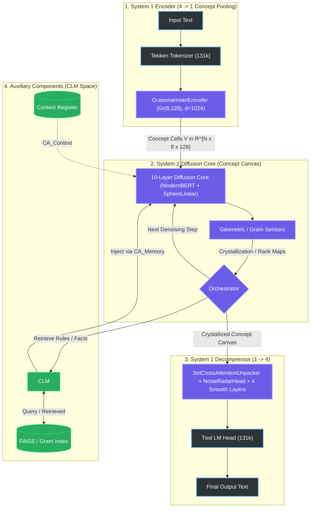

  

<h1 align="center">BEBLaDII</h1>

  
  
  
  
  

# BEBLaDII: Reasoning Latent Diffusion Model

**BEBLaDII** stands for **Bidirectional Encoder Based Latent Diffusion with Information Injection**.

## Purpose
BEBLaDII is an experimental research model designed to separate logical reasoning (System 2) from linguistic generation (System 1) and use **Complementary Latent Memory (CLM)** directly inside continuous latent space. Instead of autoregressively predicting one discrete token at a time, the current **Plan C** architecture encodes 4-token chunks into **Grassmannian Burer–Monteiro concept cells** $V \in \mathbb{R}^{8 \times 128}$ ($\rho = V^T V$, $d = 1024$), performs iterative diffusion reasoning over compressed concept canvases, and reconstructs fluent text via an $\mathcal{O}(8)$-invariant decompressor decoder.

## 💾 Model Weights
Modular System 1 components for Plan C (Phase 1 & Phase 2) are stored in `storage/components/`:
- `storage/components/tokenizer` — Tekken (Mistral AI, `vocab_size = 131,072`)
- `storage/components/encoder` — `GrassmannianEncoder` (Phase 1 `step_19500` EMA)
- `storage/components/decoder` — `GrassmannianDecoder` (Phase 2 `step_25000`, $\mathcal{O}(8)$-invariant `SetCrossAttentionUnpacker` $1 \to 4$ + `NoiseRadarHead`)
- `storage/components/sep_concept.pt` & `storage/components/void_concept.pt` — deterministic anchor concepts

Foundation weights for earlier Plan B experiments:

## Architecture (Plan C)
BEBLaDII Plan C operates over subspaces $\operatorname{Gr}(8, 128)$ factored as $V \in \mathbb{R}^{8 \times 128}$ (with orthogonal functional slices `[0:96]` Lexical Core, `[96:112]` Context Syntax, and `[112:128]` Partial RoPE Tail).

## Components

1. **Tokenizer (`storage/components/tokenizer`)**
   - **Role:** Tekken BPE tokenizer ($V = 131\,072$) with high Cyrillic compression efficiency.
2. **Grassmannian Encoder (`storage/components/encoder`)**
   - **Role:** Split-subspace encoder (`LexicalCoreMLP` + 2-layer `ContextSyntaxEncoder`) with block-diagonal $\mu$-VAE head, unit-ball normalizer ($\text{rk}_{\text{eff}} \ge 1.5$), and $4 \to 1$ Eckart–Young spectral pooler (Partial RoPE + Lorentzian Autograd SVD).
3. **Diffusion Core (System 2, Phase 3 Plan C)**
   - **Role:** Iterative Flow Matching / DDPM transformer (10-layer `GrassmannianDiffusionCore` + 2-layer `PromptAdapter`) over canonicalized concept canvases $V \in \mathbb{R}^{N \times 8 \times 128}$ trained with `OrthMuon (d=1)` and `SphereLinear`.
4. **Grassmannian Decoder (`storage/components/decoder`, Phase 2 Plan C)**
   - **Role:** Dual-output $\mathcal{O}(8)$-invariant hierarchical decompressor with deterministic basis canonicalization (`canonicalize_cell_basis`), `NoiseRadarHead` (cell/token noise estimation $\hat{\sigma}_{\text{cell}}, \hat{\sigma}_{\text{tok}}$), 1 canvas context layer, `SetCrossAttentionUnpacker` ($1 \to 4$ with Gram matrix $G = V V^T$ in FP32), 4 noise-conditioned smoothing layers, and tied LM head.
5. **CLM & Orchestrator**
   - **Role:** External geometric memory and control loop operating on subspace projections and typed relation anchors.

## Training Pipeline (Plan C)

- **Stage C.1 (Phase 1): Grassmannian Autoencoder & Base Decompressor** (✅ Completed at `step_19500`)
  - Dual-regime training (85% coherent text + 15% vocabulary spectrum `randperm(131k)`), `OrthMuon (d=1)` + `AdamW`, Denoising Jittering (`0.035`), diagonal/off-diagonal Gram prior regularization.
  - Achieved `val/recon = 0.0014`, `100%` Token Accuracy (`PPL = 1.00–1.02`), `val/effective_dim = 64.39 / 128` (`47.51 / 128` on text-only scan), zero collapsed tokens, and clean quantum-boolean subspace algebra.
- **Stage C.2 (Phase 2): Generative $\mathcal{O}(8)$-Invariant Decoder & Noise Radar** (✅ Completed at `step_25000`)
  - Trained on frozen Phase 1 `GrassmannianEncoder` and tied `embeddings.weight` with deterministic $\mathcal{O}(8)$ basis canonicalization (`canonicalize_cell_basis`) and word-aware elastic chunking (`WordAwareElasticChunker`, `1..4` BPE tokens without splitting words $\le 4$ tokens).
  - Upgraded `GrassmannianDecoder` to a dual-output architecture: `NoiseRadarHead` (predicting per-cell/per-token noise $\hat{\sigma}_{\text{cell}}, \hat{\sigma}_{\text{tok}}$) and a 4-layer noise-conditioned generative smoothing contour trained under realistic latent corruptions (`clean_jitter`, strong Gaussian noise, barycentric `MixOther`, partial crystallization, and random $\mathcal{O}(8)$ rotations).
- **Stage C.3 (Phase 3): Concept-Canvas Diffusion Core** (🚧 In Progress)
  - Train the 10-layer `GrassmannianDiffusionCore` + 2-layer `PromptAdapter` (`CA_Prompt`, `Shared KV`, `Soft-Gate AdaLN`) over canonicalized concept canvases ($N = 128$ with `SEP` anchor at pos `0`), using `WordAwareElasticChunker`, diagnostic spectral + `NoiseRadarHead` sensors (`s0..s7`), `Two-Step Rollout`, hybrid Grassmannian losses, and end-to-end token Cross-Entropy (`L_CE`) through the frozen decoder.
- **Stage C.4–C.5: CLM Integration & End-to-End Inference** (Planned)
  - Connect CLM rule/fact indexing via Gram invariants and run end-to-end prompt-conditioned latent reasoning.

## Results & Reports

### Plan C (Current)
* [Plan C Architecture & Foundations](<experiments/plan C.md>)
* **Phase 1 (Completed — `step_19500` EMA):**
  * [Phase 1 Experiment Plan](<experiments/phase 1/experiment_plan.md>)
  * [Training Pipeline](<experiments/phase 1/train_phase1.py>)
* **Phase 2 (Completed — `step_25000`):**
  * [Phase 2 Experiment Plan (Generative Decoder & Noise Radar)](<experiments/phase 2/experiment_plan.md>)
  * [Training Pipeline](<experiments/phase 2/train_phase2.py>)
* **Phase 3 (In Progress):**
  * [Phase 3 Experiment Plan (Diffusion Core)](<experiments/phase 3/experiment_plan.md>)
  * [Training Pipeline](<experiments/phase 3/train_phase3.py>)

### Plan B (failed)
Old README: [README Plan B](<experiments/Plan B/README.md>) | Experiment folder: [experiments/Plan B](<experiments/Plan B>)
* Phase 1
  * [Phase 1 Latent space creation](reports/plan_B/plan_b_phase1_report.md)
* Phase 2
  * [Phase 2 Decoder training](reports/plan_B/plan_b_phase2_report.md)
* Phase 3
  * [Phase 3 Same-Noise Diffusion core training](reports/plan_B/plan_b_phase3_report.md)
* Phase 4
  * [Phase 4 Hierarchical Per-Token Noise Diffusion training](reports/plan_B/plan_b_phase4_report.md)
* Phase 5
  * [Phase 5 Sensor ensemble exploration](reports/plan_B/plan_b_phase5_report.md)

### Plan A (failed)
Old README: [README Plan A](<experiments/Plan A/README.md>) | Experiment folder: [experiments/Plan A](<experiments/Plan A>)
* Phase 1
  * [Phase 1 Awakening Report](reports/plan_A/phase1_awakening_report.md)
* Phase 2
  * [Phase 2 Reasoning Report: Failures retrospective](reports/plan_A/phase2_failures_retrospective.md)
  * [Phase 2 Reasoning and Topology Report](reports/plan_A/phase2_reasoning_and_topology_report.md)
* Phase 3
  * [Phase 3 Output projector Report: Failures retrospective](reports/plan_A/phase3_failures_retrospective.md)

## Acknowledgments

This project builds upon the foundational work of the open-source AI community:
* **ModernBERT** (Reasoning engine base architecture) is released under the **Apache 2.0 License**.
* **Mistral NeMo / Tekken** (Tokenizer and SVD embedding initialization) is released under the **Apache 2.0 License**.

Special thanks to:
* **Google** for providing the **Cloud TPU** computational resources that made earlier large-scale training and distillation experiments possible.
* **Antigravity** (AI IDE) for invaluable pair-programming assistance, debugging, and continuous code generation support throughout the development of BEBLaDII.

## Citation

> [!IMPORTANT]
> **Mandatory Attribution**
> If you utilize the code in this repository, or if you build upon the core architectural concepts of the **Reasoning Latent Diffusion** framework (Latent Diffusion-based reasoning via iterative latent refinement), **citation is strictly required**. Intellectual credit must be given for both the implementation and the underlying theoretical framework.

Please use the provided [CITATION.cff](CITATION.cff) file or the following metadata:
- **Title**: BEBLaDII: Bidirectional Encoder Based Latent Diffusion with Information Injection
- **Author**: Bogdan Buliakov
- **URL**: [https://github.com/Laeryid/BEBLaDII](https://github.com/Laeryid/BEBLaDII)
