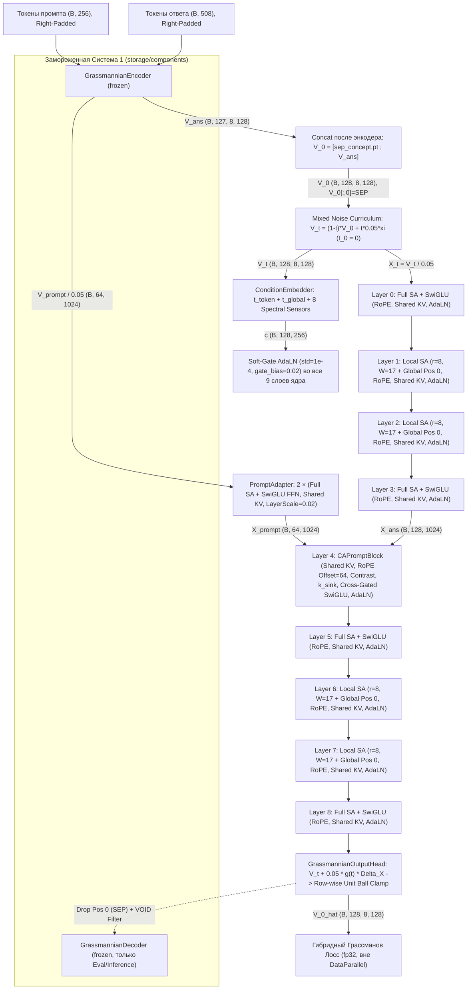

# План реализации: Фаза 2 Plan C (Условное ядро латентной диффузии на холсте Грассманиана с `CA_Prompt`)

**Статус:** Реализован, проверен архитектурными тестами и `--smoke-test`  
**Дата:** Ноябрь 2026  
**Директория:** `experiments/phase 2/`  
**Целевая платформа:** Kaggle 2×T4 (`sm_75`, 2×16 ГБ VRAM, `DDP` / `DataParallel` с внешним расчётом лосса, `FP16` + `GradScaler` + `FP32` инварианты; TPU v6e — опциональный резерв)  
**Связанные документы:**
- [experiments/phase 1/experiment_plan.md](file:///C:/Experiments/BEBLaDII/experiments/phase%201/experiment_plan.md) — Архитектура и итоги Системы 1 (`step_19500` EMA).
- [experiments/plan C.md](file:///C:/Experiments/BEBLaDII/experiments/plan%20C.md) — Базовая концепция Plan C.
- [experiments/plan_C_math_foundations.md](file:///C:/Experiments/BEBLaDII/experiments/plan_C_math_foundations.md) — Математический фундамент подпространств $\mathbb{R}^{8 \times 128} / \mathcal{O}(8)$.
- [test_phase2_open_questions.py](file:///C:/Experiments/BEBLaDII/experiments/phase%202/test_phase2_open_questions.py) — Воспроизводимый скрипт-тест эмпирических проверок и замеров Q1–Q7.
- Наработки из `ideas/`: [articles index.md](file:///C:/Experiments/BEBLaDII/ideas/articles%20index.md), [diffusion_readiness_metrics.md](file:///C:/Experiments/BEBLaDII/ideas/diffusion_readiness_metrics.md), [idea_kalman_vs_heuristic_canvas_update.md](file:///C:/Experiments/BEBLaDII/ideas/idea_kalman_vs_heuristic_canvas_update.md), [semantic_clm_compression.md](file:///C:/Experiments/BEBLaDII/ideas/semantic_clm_compression.md), [Starting_Templates_Prior.md](file:///C:/Experiments/BEBLaDII/ideas/Starting_Templates_Prior.md).

---

## 0. Pre-Edit Context Gate (Mandatory Planning Template)

- **Affected layers**:
  - Новая экспериментальная подсистема `experiments/phase 2/`: `experiment_plan.md` (текущий документ), [test_phase2_open_questions.py](file:///C:/Experiments/BEBLaDII/experiments/phase%202/test_phase2_open_questions.py), в дальнейшем после подтверждения — `train_phase2.py`, `export_to_notebook.py`, `inspect_phase2_generation.py`.
  - Взаимодействие с существующим кодом строго в режиме *read-only* через экспортированные компоненты Системы 1: [storage/components/encoder/__init__.py](file:///C:/Experiments/BEBLaDII/storage/components/encoder/__init__.py), [storage/components/decoder/__init__.py](file:///C:/Experiments/BEBLaDII/storage/components/decoder/__init__.py), [storage/components/plan_c_layers.py](file:///C:/Experiments/BEBLaDII/storage/components/plan_c_layers.py), `storage/components/tokenizer/`, `storage/components/sep_concept.pt`, `storage/components/void_concept.pt`.
- **Read KIs**:
  - [.know/knowledge/_OVERVIEW.ki.md](file:///C:/Experiments/BEBLaDII/.know/knowledge/_OVERVIEW.ki.md)
  - [.know/knowledge/KI_clm_geometric_pooling.md](file:///C:/Experiments/BEBLaDII/.know/knowledge/KI_clm_geometric_pooling.md)
  - Контекст Системы 1 (`experiments_phase_1_system_1_autoencoder.ki.md`) и актуальные ADR:
    - **Plan C**: ADR `123` (FP16 переполнение матрицы Грама), `125`–`127` (численная устойчивость), `128` (спектральный пулинг со взвешиванием стоп-слов), `131` (`OrthMuon d=1` + `QK-norm`), `132` (невырожденный 8-осевой `VOID`), `134` (экспорт Системы 1).
    - **Plan B (механика `CA_Prompt` и `AdaLN`)**: ADR `062` (Pre-LN + AdaLN порядок), `064` и `074` (ранний Micro-Noise Init `std=1e-3` + Diversity Loss и его последующий откат к Zero Init), `065` (Identity Gate), `108` (`RoPE` в Cross-Attention и анти-барицентрический лосс), `109` (`Prompt Dropout 15%` для CFG), `118` (`Token-Centered Contrast`, `Zero-Vector Attention Sink k_sink`, `Cross-Gated GeGLU`), `119` (переход к Plan C). Спецификация `Soft-Gate AdaLN` (`std=1e-4`, `gate_bias=0.02`) и пола $\sigma_{\text{adaln}}$ в Фазе 2 зафиксирована в [ADR 135](file:///C:/Experiments/BEBLaDII/.know/decisions/135_phase2_planc_softgate_adaln_shared_kv_and_loss_calibration.md) (ADR `105` относится к другой задаче Phase 6).
- **KIs Constraints**:
  1. **[MUST]** Замороженные веса `GrassmannianEncoder` и `GrassmannianDecoder` переводятся в `.eval()` с `requires_grad_(False)` и не изменяются в Фазе 2.
  2. **[MUST]** На GPU NVIDIA T4 (`sm_75`) отсутствует аппаратный `bfloat16`; используется `torch.float16` autocast + `GradScaler`, поэтому все расчёты матриц Грама $G = V V^T$, норм Фробениуса, спектрального ранга $\operatorname{rk}_{\text{eff}}$, `RMSNorm`, `SwiGLU` (с клампом `[-65000.0, 65000.0]` как на `gate * up`, так и на выходе `down_proj`) и `AdaLN`-модуляций обязаны выполняться с защитой от переполнения FP16 (`> 65504`).
  3. **[MUST]** Перед параллельным запуском на 2×T4 вызывается `warmup_linalg_backends(device)` для исключения гонок инициализации cuSOLVER/cuBLAS.
  4. **[MUST NOT]** Применять `.view()` к результатам `transpose()` в слоях внимания — использовать исключительно `.reshape()` или `.contiguous().view()`.
  5. **[MUST NOT]** Использовать вырожденный 1-осевой `VOID` из ранних черновиков `plan C.md` — в качестве канонического пустого концепта используется исключительно 8-осевой тензор из `storage/components/void_concept.pt`.

---

## 1. Результаты эмпирической верификации Системы 1 (`step_19500`) на `N_ans = 127` (508 токенов) и `N = 128` (512 токенов)

Замороженные `GrassmannianEncoder` и `GrassmannianDecoder` из [storage/components/](file:///C:/Experiments/BEBLaDII/storage/components) проверены на последовательностях базовой длины $N = 64$ (256 токенов), целевой длины генерации $N_{\text{ans}} = 127$ (508 токенов Tekken) и полного холста $N = 128$ (512 токенов).

### 1.1. Качество реконструкции и масштаб длин
| Режим проверки | Длина холста $N$ (токены $4N$) | Точность смысловых токенов | Статус `PrecomputedRoPE` |
| :--- | :---: | :---: | :--- |
| Базовая длина Фазы 1 | `64` (256 токенов) | **100.00%** *(99.45% на длинных RU-текстах)* | Штатно (предвычислен до 4096) |
| Целевая длина генерации (`N_ans`) | **`127` (508 токенов)** | **99.67%** (5063 / 5080 на полных; 99.41% с `PAD`) | **Штатно без искажений (идентично `N=128`: 99.65%)** |
| Полный холст диффузии (`N=128`) | **`128` (512 токенов)** | **100.00%** (500 / 500 смысловых токенов) | **Штатно без единого изменения весов** |

### 1.2. Эмпирическая геометрия ячеек Грассманиана и нормированная мера $\operatorname{Sim}_{\text{Gr}}$
Замер распределения матриц $V_i \in \mathbb{R}^{8 \times 128}$ на реальном тексте (включая мультидоменный корпус из 20 405 полных ячеек по 5 доменам, §8 Q7) показал следующие константы пространства:
- **Смысловые концепт-ячейки (`V_content`)**:
  - Квадрат нормы Фробениуса клетки: $\|V_i\|_F^2 = \operatorname{Tr}(G_i) = \mathbf{2.5196}$ на эталонном тексте ($\mathbf{2.4151 \pm 0.4369}$ в среднем по 5 доменам, $\|V_i\|_F \approx \mathbf{1.55\dots 1.59}$);
  - Среднеквадратичный масштаб компоненты: $\sigma_{\text{data}} = \operatorname{RMS}(V_i) \approx \mathbf{0.0496}$ на эталонном тексте ($\mathbf{0.0484 \pm 0.0044}$ по 5 доменам, междоменный диапазон $[0.0448, 0.0519]$, т.е. в пределах $[-10.4\%, +3.8\%]$ вокруг фиксированной константы $\mathbf{0.05}$);
  - Средняя $L_2$-норма отдельной строки (оси $v_{i,k} \in \mathbb{R}^{128}$): $\|v_{i,k}\|_2 \in [\mathbf{0.434, 0.544}] \le 1.0$, средний эффективный ранг $\operatorname{rk}_{\text{eff}} \in [\mathbf{4.05, 4.81}]$.
- **Разделитель начала ответа (`sep_concept.pt`, скомпилирован оффлайн из `[" think", " reason", " logic", " canvas"]`)**:
  - $\|V_{\text{sep}}\|_F^2 = \mathbf{2.5280}$, $\operatorname{RMS}(V_{\text{sep}}) = \mathbf{0.0497}$, $\operatorname{rk}_{\text{eff}} = \mathbf{6.20}$.
- **Пустая ячейка (`void_concept.pt`, 8-осевой репер)**:
  - $\|V_{\text{void}}\|_F^2 = \mathbf{0.046104}$, $\operatorname{RMS}(V_{\text{void}}) = \mathbf{0.006687}$;
  - Спектр жёстко упакован в хвост координат `[104:128]` с убывающими амплитудами $\lambda_k = 0.01 \cdot 0.6^k$ ($k = 0 \dots 7$).

#### Строго нормированное Грассманово косинусное сходство операторов плотности ($\operatorname{Sim}_{\text{Gr}}$)
Пусть $\rho_A = A^T A \in \mathbb{R}^{128 \times 128}$ и $\rho_B = B^T B \in \mathbb{R}^{128 \times 128}$ — операторы плотности двух клеток $A, B \in \mathbb{R}^{8 \times 128}$, а $G_A = A A^T \in \mathbb{R}^{8 \times 8}$ и $G_B = B B^T \in \mathbb{R}^{8 \times 8}$ — их внутренние матрицы Грама.
Поскольку $\|\rho_A\|_F = \sqrt{\operatorname{Tr}(\rho_A^2)} = \sqrt{\operatorname{Tr}(G_A^2)} = \|A A^T\|_F$ (а **не** $\|A\|_F^2 = \operatorname{Tr}(G_A)$, иначе при $A=B$ отношение давало бы спектральную чистоту $p = \operatorname{Tr}(G^2)/\operatorname{Tr}(G)^2 \approx 1/8$ вместо $1$), **нормированное $\mathcal{O}(8)$-инвариантное сходство подпространств** определяется как косинус Гильберта–Шмидта между матрицами плотности:
$$\operatorname{Sim}_{\text{Gr}}(A, B) \triangleq \frac{\langle \rho_A, \rho_B \rangle_F}{\|\rho_A\|_F \, \|\rho_B\|_F + \varepsilon} = \frac{\|A B^T\|_F^2}{\|A A^T\|_F \, \|B B^T\|_F + \varepsilon} \in [0, 1], \qquad \varepsilon = 10^{-8}$$
- **Точная калибровка**: по неравенству Коши–Буняковского $\operatorname{Sim}_{\text{Gr}}(A, B) \in [0, 1]$, причём $\operatorname{Sim}_{\text{Gr}}(A, B) = 1.0 \iff \rho_A \propto \rho_B$ (совпадение подпространств и относительного спектра с точностью до любого ортогонального вращения $R \in \mathcal{O}(8)$) при любом эффективном ранге $\operatorname{rk}_{\text{eff}} \in [1, 8]$.
- **Вычислительная дешевизна**: все матрицы $A B^T, A A^T, B B^T$ имеют размер $8 \times 8$ и вычисляются в `float32` без `SVD`/`QR`.

### 1.3. Критический инвариант декодирования `VOID` и калибровка шума
1. **Детекция конца ответа (`PAD` / `VOID`) в латенте до декодера**:
   В Фазе 1 ([train_phase1.py](file:///C:/Experiments/BEBLaDII/experiments/phase%201/train_phase1.py#L1691-L1693)) `PAD`-хвост маскировался через `targets[n_real:] = -100`, поэтому линейная голова декодера не обучалась выдавать `pad_token_id = 10` (`PAD Acc = 0.00%` по argmax логитов).
   Зато в латентном пространстве между `V_content` ($\|V\|_F^2 \approx 2.52$) и чистой `VOID`-клеткой ($\|V\|_F^2 \approx 0.0461$) имеется **55-кратный энергетический зазор** и ортогональность носителей (`[0:96]` vs `[104:128]`). При валидации и инференсе чистые `VOID`-ячейки определяются **до** вызова `GrassmannianDecoder` по критерию с корректно нормированным $\operatorname{Sim}_{\text{Gr}}$:
   $$\text{is\_void}(i) \iff \left(\|\hat{V}_{0,i}\|_F^2 < 0.35\right) \;\lor\; \left(\operatorname{Sim}_{\text{Gr}}(\hat{V}_{0,i}, V_{\text{void}}) > 0.80\right)$$
   после чего `VOID`-хвост отсекается.
2. **Калибровка масштаба гауссова шума ($\sigma_{\text{noise}}$)**:
   Так как эмпирическое СКО компонент смысловых ячеек равно $\sigma_{\text{data}} = 0.050$, линейная интерполяция к гауссову шуму задаётся в масштабе Грассманиана:
   $$V_t = (1 - t)\,V_0 + t\,\sigma_{\text{noise}}\,\xi, \qquad \xi \sim \mathcal{N}(0, I_{8 \times 128}), \qquad \sigma_{\text{noise}} = \mathbf{0.050}$$
   При $t = 1$ средняя энергия чистого шума равна $1024 \cdot 0.050^2 = 2.56$, что в точности совпадает со средней энергией чистых смысловых клеток ($\|V_0\|_F^2 \approx 2.52$).

---

## 2. Нормировка остаточного потока ($\operatorname{RMS} = 1$) и Архитектура `PromptAdapter` (`2 × full SA`)

### 2.1. Согласование масштабов между $V \in \mathbb{R}^{8 \times 128}$ и слоями `SphereLinear`
Компоненты матриц $V_t$ и $V_{\text{prompt}}$ имеют масштаб $\sigma_{\text{data}} \approx 0.05$, тогда как внутри трансформерных блоков после `RMSNorm` и `SphereLinear` тензоры имеют масштаб $\mathcal{O}(1)$. Если складывать выход слоёв напрямую с ненормированным $V$ ($H = V + \alpha \Delta H$), то даже при $\alpha = 0.1$ возмущение $\Delta H \sim 0.1$ окажется в 2 раза больше самого сигнала $V \sim 0.05$ («якорь утонет в масштабе»).

**Решение (Unit-RMS Residual Stream)**:
1. На входе ядра и `PromptAdapter` тензоры Грассманиана приводятся к единичному среднеквадратичному масштабу ($\operatorname{RMS} \approx 1.0$) делением на фиксированную константу $\sigma_{\text{data}} = 0.05$:
   $$X_t^{(0)} = \frac{V_t}{\sigma_{\text{data}}}, \qquad X_{\text{prompt}}^{(0)} = \frac{V_{\text{prompt}}}{\sigma_{\text{data}}}, \qquad \sigma_{\text{data}} = 0.05$$
2. Все внутренние остаточные связи в 9 слоях ядра и 2 слоях `PromptAdapter` работают в этом нормированном пространстве $\operatorname{RMS} \approx 1.0$:
   $$X_{\text{ans}}^{(l+1)} = X_{\text{ans}}^{(l)} + \Delta X_{\text{ans}}^{(l)}, \qquad X_{\text{prompt}}^{(m+1)} = X_{\text{prompt}}^{(m)} + \alpha_m \odot \Delta X_{\text{prompt}}^{(m)}$$
   где вектор `layer_scale` $\alpha_m \in \mathbb{R}^{1024}$ в `PromptAdapter` инициализируется значением $\alpha_0 = \mathbf{0.02}$ (даёт мягкое $2\%$-е возмущение относительно $X_{\text{prompt}}^{(0)}$ на старте).
3. На выходе `GrassmannianOutputHead` предсказанная поправка $\Delta X_{\text{out}}$ умножается обратно на $\sigma_{\text{data}} = 0.05$ перед сложением с $V_t$:
   $$\hat{V}_0^{\text{raw}} = V_t + \sigma_{\text{data}} \cdot g(t_i) \cdot \Delta X_{\text{out}}$$

### 2.2. Почему `PromptAdapter` выделен в отдельные `2 × full SA` (с `SwiGLU FFN`)
1. **Отсутствие конфликта градиентов (`t = 0` vs `t -> 1`)**: слои `0..3` ядра не тратят ёмкость на одновременную обработку чистого текста ($t = 0$) и сильного шума ($t \to 1$), а специализируются исключительно на денойзинге холста ответа.
2. **Полное двустороннее поле зрения**: в отличие от слоёв `1` и `2` ядра (которые являются локальными), оба слоя `PromptAdapter` используют **полное внимание (`Full SA`)** + `SwiGLU FFN` (`intermediate_size = 2816`), без `AdaLN(t)`.
3. **Кэширование при инференсе и честное выравнивание в `CA`**:
   - При многошаговой генерации (16–25 шагов) `PromptAdapter` запускается **один раз** до цикла диффузии.
   - Согласование пространств между $X_{\text{ans}}^{(4)}$ и $X_{\text{prompt}}^{(2)}$ на входе `CAPromptBlock` обеспечивается тем, что оба остаточных потока имеют единый масштаб $\operatorname{RMS} \approx 1.0$, проходят через `RMSNorm(1024)` и отображаются обучаемыми сферическими проекциями `q_proj` и `kv_proj` в общее пространство голов внимания $\mathbb{R}^{8 \times 128}$ с по-осевым `QK-norm`.

---

## 3. Архитектура 9-слойного ядра диффузии (`GrassmannianDiffusionCore`)

### 3.1. Послойная конфигурация ядра, локальное окно $r = 8$ ($W = 17$) и якорь `SEP` на позиции `0`
- **Базовые гиперпараметры**: `hidden_size = 1024`, `num_heads = 8` (**1 голова внимания = 1 ось Грассманиана размерности `head_dim = 128`**), `intermediate_size = 2816` (`SwiGLU`), `Pre-LN RMSNorm` (`fp32`).
- **Порядок слоёв ядра (9 блоков)**:
  - `0: Full SA` $\to$ `1: Local SA` $\to$ `2: Local SA` $\to$ `3: Full SA` $\to$ `4: CA (CAPromptBlock)` $\to$ `5: Full SA` $\to$ `6: Local SA` $\to$ `7: Local SA` $\to$ `8: Full SA`.
- **Единое определение локального окна (`Layers 1, 2, 6, 7`)**:
  - Используется двустороннее скользящее окно **радиуса $r = 8$ ячеек** вокруг текущей позиции $i$ ($|i - j| \le 8$, что даёт **полную ширину окна $W = 2r + 1 = 17$ ячеек** = 68 токенов), плюс **глобальный аттрактор на позиции `0`** (каждая ячейка $i$ всегда видит ячейку `0`, а ячейка `0` видит все 128 ячеек холста).
- **Детерминированный якорь `SEP` на позиции `0` (в 100% примеров при обучении и инференсе)**:
  - Чтобы слои локального внимания `1, 2, 6, 7` всегда опирались на предсказуемый глобальный хаб на позиции `0`, ячейка `idx = 0` холста ответа **всегда (в 100% примеров на обучении и в 100% запусков при инференсе)** заполняется эталонным концептом `sep_concept.pt` с нулевым уровнем шума $t_0 \equiv 0.0$.
  - **Порядок формирования холста:** в `GrassmannianEncoder` подаются **только 508 токенов ответа** (right-padded `PAD`) → $V_{\text{ans}} \in \mathbb{R}^{B \times 127 \times 8 \times 128}$. `sep_concept.pt` **подставляется после энкодера, перед началом диффузии**: $V_0 = [V_{\text{sep}};\, V_{\text{ans}}] \in \mathbb{R}^{B \times 128 \times 8 \times 128}$. Токены `SEP` в энкодер не подаются.
  - Содержательный текст ответа располагается в ячейках `1..127` ($127$ концепт-ячеек = $508$ токенов Tekken). При декодировании в текст ячейка `0` всегда отбрасывается (`V_ans[:, 1:]`, ровно 127 ячеек, что соответствует входу энкодера; формат $N=127$ см. вопрос Q1 в §8).

### 3.2. Единая матрица $K$ и $V$ (`Shared KV Projection` + `Split K/V Channel Gating`) во всех 11 слоях
Во всех **11 блоках внимания** (`2` слоя `PromptAdapter` + `8` слоёв `SA` ядра + `1` слой `CAPromptBlock`) вместо трёх матриц $(W_Q, W_K, W_V)$ используются две полноранговые сферические матрицы:
- `q_proj: SphereLinear(1024, 1024, bias=False)`
- `kv_proj: SphereLinear(1024, 1024, bias=False)`

**Три обязательных инварианта `Shared KV`**:
1. **Разветвление строго ДО `QK-norm` и `RoPE`**:
   Вычисляется $U = \operatorname{kv\_proj}(X) \in \mathbb{R}^{B \times 8 \times L \times 128}$. Ветка значений $V$ **никогда не вращается через `RoPE`**, чтобы исключить деструктивную интерференцию фаз при суммировании в Softmax.
2. **Раздельный канальный фильтр (`Split K/V Channel Gate`)**:
   - Для ключей $K$ применяется по-головочный `k_norm = RMSNorm(128)` ($\gamma_K \in \mathbb{R}^{8 \times 128}$) и `RoPE`;
   - Для значений $V$ применяется обучаемый канальный гейт `v_gate` $\in \mathbb{R}^{1 \times 8 \times 1 \times 128}$ (инициализация `1.0`, оптимизируется `AdamW`, +1024 параметра на слой):
   $$K = \operatorname{RoPE}\!\big(\operatorname{k\_norm}(U)\big), \qquad V = \text{v\_gate} \odot U$$
3. **Разделение центрирования в `CAPromptBlock` (Слой 4)**:
   Вычитание среднего по не-`VOID` клеткам промпта (`Token-Centered Contrast`, ADR 118) применяется **только к ветке ключей $K$**, оставляя ветку значений $V$ нецентрированной:
   $$U_p = \operatorname{kv\_proj}(X_{\text{prompt}}), \qquad K_p = \operatorname{RoPE}\!\big(\operatorname{k\_norm}(U_p - 0.5\,\bar{U}_p)\big), \qquad V_p = \text{v\_gate} \odot U_p$$

---

## 4. Управляющие сигналы (`ConditionEmbedder` + `Soft-Gate AdaLN`) и `CAPromptBlock`

### 4.1. `ConditionEmbedder`: Подача шума и спектральных метрик в каждый слой
Для каждой ячейки холста $i \in \{0, \dots, 127\}$ формируется вектор управления $c_i \in \mathbb{R}^{B \times 128 \times 256}$ на основе:
1. **Локальный уровень шума ячейки $t_i \in [0, 1]$**: `SinusoidalTimeEmbedding(128)`.
2. **Глобальный средний шум холста $\bar{t} = \frac{1}{127}\sum_{j=1}^{127} t_j$**: `SinusoidalTimeEmbedding(64)`.
3. **Вектор аналитических спектральных датчиков $s_i \in \mathbb{R}^{8}$** (считается в `torch.float32` из входного $V_{t,i}$):
   - $s_{i,0} = \min(\|V_{t,i}\|_F^2 / 2.52,\; 2.0)$ — нормированная энергия ячейки;
   - $s_{i,1} = p_i = \frac{\|G_{t,i}\|_F^2}{(\operatorname{Tr}(G_{t,i}) + 10^{-6})^2}$ — спектральная чистота подпространства ($G_{t,i} = V_{t,i} V_{t,i}^T \in \mathbb{R}^{8 \times 8}$);
   - $s_{i,2} = \frac{1}{8\,p_i}$ — нормированный эффективный ранг $\operatorname{rk}_{\text{eff}}(V_{t,i}) / 8 \in (0, 1]$;
   - $s_{i,3} = \operatorname{Sim}_{\text{Gr}}(V_{t,i}, V_{\text{void}}) = \frac{\|V_{t,i} V_{\text{void}}^T\|_F^2}{\|G_{t,i}\|_F \|G_{\text{void}}\|_F + 10^{-8}} \in [0, 1]$ — нормированное Грассманово сходство с `VOID`;
   - $s_{i,4} = \mathbb{I}[t_i < 10^{-3}]$ — флаг чистого/зафиксированного якоря (`SEP` и чистые клетки инпейнтинга);
   - $s_{i,5} = m_{\text{prompt}} \in \{0, 1\}$ — флаг активности промпта ($0$ при полном CFG-дропауте промпта);
   - $s_{i,6}, s_{i,7} = 0.0$ — два резервных канала под сигналы Оркестратора / фильтра Калмана на Фазе 3–4.

Объединённый вектор $(128 + 64 + 8 = 200)$ проецируется через 2-слойный MLP (`200 -> 256 -> 256`, `SiLU`, `LayerNorm`) в `c: (B, 128, 256)`.

**Инициализация `Soft-Gate AdaLN` в каждом из 9 слоёв**:
- Каждый слой содержит линейную проекцию `Linear(256, 6 * 1024)` $\to$ `(shift_msa, scale_msa, gate_msa, shift_mlp, scale_mlp, gate_mlp)`.
- Веса `weight` инициализируются нормальным распределением со **стандартным отклонением** $\text{std} = 10^{-4}$ ($W \sim \mathcal{N}(0, 10^{-8})$).
- Вектор `bias` инициализируется нулями для `shift_*` и `scale_*` (применяется формула $x \cdot (1 + \text{scale}) + \text{shift}$), а для резидуальных ворот `gate_msa` и `gate_mlp` `bias` полагается равным $\mathbf{0.02}$. При нормированном остаточном потоке ($\operatorname{RMS} = 1$) это даёт мягкий вклад каждого блока ($2\%$) на старте и гарантирует ненулевой градиент во все внутренние матрицы с 1-го шага.
- При такой инициализации и межтокеновом разбросе выхода `ConditionEmbedder` $\operatorname{std}(c) \approx 0.052$ стартовое стандартное отклонение модуляций составляет $\sigma_{\text{adaln}}^{(l)} \approx 8.15 \cdot 10^{-5}$ (§8 Q6), поэтому регуляризатор пола разнообразия $\mathcal{L}_{\text{adaln}}$ включается плавно с линейным разогревом за первые `500` шагов.

### 4.2. Детальное устройство `CAPromptBlock` (Слой 4) и Паддинг промпта
1. **Правый паддинг промпта (`Right Padding`) и фиксированное смещение `RoPE` (`offset = 64`, ADR 108)**:
   - Токены промпта всегда выравниваются **по левому краю** и дополняются `PAD`-токенами **справа** до длины $4 N_p = 256$ токенов ($N_p = 64$ концепт-клетки).
   - Ключи промпта $K_p$ получают позиции `RoPE` $[0, \dots, 63]$ (смысловое начало вопроса всегда стоит в позиции `0`), а запросы холста ответа $Q_a$ всегда получают смещённые позиции $[64, \dots, 191]$ (`offset = 64`). Таким образом, относительная фаза `RoPE` между началом вопроса и началом ответа строго инвариантна к длине текста вопроса.
2. **Маскирование `VOID`-хвоста промпта**: ячейки промпта, где все 4 токена являются `PAD` ($n_{\text{real}} = 0$, $\|V_{\text{prompt}, j}\|_F^2 < 0.15$), маскируются аддитивным сентинелом `-10000.0`.
3. **Zero-Vector Attention Sink (`k_sink`, ADR 118)**:
   - К 64 ключам промпта добавляется 1 обучаемый ключ $k_{\text{sink}} \in \mathbb{R}^{1 \times 8 \times 1 \times 128}$ (без `RoPE`) с фиксированным нулевым значением $v_{\text{sink}} \equiv \mathbf{0}$.
4. **Двойная регуляризация промпта при обучении**:
   - **Full Prompt Dropout (15%, ADR 109)**: с вероятностью `0.15` все 64 ключа промпта маскируются (`-10000.0`), открытым остаётся только `k_sink`, а `m_prompt = 0.0` (обучение безусловной ветки для CFG).
   - **Semantic Cell Pruning Dropout ([semantic_clm_compression.md](file:///C:/Experiments/BEBLaDII/ideas/semantic_clm_compression.md))**: с вероятностью `0.50` среди остальных примеров случайно маскируются `25%` смысловых ячеек промпта.
5. **Cross-Gated SwiGLU FFN (ADR 118)**:
   $$h_{\text{ca}} = \operatorname{o\_proj}(\operatorname{Attn}(Q_a, K_p \Vert k_{\text{sink}}, V_p \Vert \mathbf{0})), \qquad \operatorname{gate} = \operatorname{SiLU}\!\big(\operatorname{gate\_proj}(h_{\text{ca}}) + \operatorname{W\_canvas\_gate}(\tilde{X}_{\text{ans}})\big)$$
   Выходное произведение `gate * up_proj(h_ca)` и выход `down_proj` защищаются клампом `[-65000.0, 65000.0]`.

### 4.3. Выходная голова (`GrassmannianOutputHead`) и Построчный шар $\mathbb{B}^{128}$
1. **Зануление поправки на чистых якорях ($t_i = 0$)**:
   Чтобы чистые ячейки ($t_i = 0$, включая `SEP` на позиции `0` и открытые якоря при инпейнтинге) не искажались сетью, остаточная поправка умножается на гладкий гейт времени $g(t_i) = \min(t_i / 0.02,\; 1.0)$:
   $$\hat{V}_0^{\text{raw}} = V_t + \sigma_{\text{data}} \cdot g(t_i) \cdot \operatorname{out\_proj}\!\big(\operatorname{RMSNorm}(X_{\text{ans}}^{(8)}) \odot (1 + \text{scale}_{\text{out}}) + \text{shift}_{\text{out}}\big)$$
   При $t_i = 0$ имеем $g(0) = 0 \implies \hat{V}_{0,i}^{\text{raw}} \equiv V_{t,i} = V_{0,i}$ тождественно.
2. **Построчное сжатие в единичный шар $\mathbb{B}^{128}$ (`clamp_to_unit_ball`)**:
   Метод `CoordinateNormalizer.clamp_to_unit_ball` из [plan_c_layers.py](file:///C:/Experiments/BEBLaDII/storage/components/plan_c_layers.py#L140-L150) применяется **к каждой из 8 строк (осей) $v_{i,k} \in \mathbb{R}^{128}$ независимо**, а не к норме Фробениуса всей матрицы:
   $$\hat{v}_{0,i,k} = \begin{cases} \hat{v}_{0,i,k}^{\text{raw}}, & \|\hat{v}_{0,i,k}^{\text{raw}}\|_2 \le 1.0 \\ \frac{\hat{v}_{0,i,k}^{\text{raw}}}{\|\hat{v}_{0,i,k}^{\text{raw}}\|_2 + 10^{-6}}, & \|\hat{v}_{0,i,k}^{\text{raw}}\|_2 > 1.0 \end{cases}$$
   Поскольку у чистых данных средняя норма строки равна $\|v_{i,k}\|_2 \approx 0.5437 < 1.0$ (при норме Фробениуса клетки $\|V_i\|_F \approx 1.587 \le \sqrt{8}$), построчный клэмп не срезает чистые данные и строго соблюдает геометрию Фазы 1.

---

## 5. Данные, Граничные ячейки, Расписание шума и Функция потерь

### 5.1. Структура холста ответа и Классификация граничных ячеек
- Ячейка `idx = 0`: всегда содержит `sep_concept.pt` ($t_0 = 0$).
- Ячейки `idx = 1..127`: кодируют до $508$ токенов ответа с правым дополнением `PAD` (`pad_token_id = 10`) и весами пулинга Фазы 1 ($w_{\text{content}} = 1.0$, $w_{\text{stop}} = 0.02$, $w_{\text{pad}} = 0.001$).
- **Разбор смешанной граничной ячейки (`Mixed Boundary Cell`)**:
  Пусть $n_{\text{real}}(i) \in \{0, 1, 2, 3, 4\}$ — число реальных (не-`PAD`) токенов в 4-токенном окне ячейки $i \ge 1$.
  - Если текст заканчивается не кратно 4 токенам, последняя содержательная ячейка $i_{\text{last}}$ имеет $n_{\text{real}}(i_{\text{last}}) \in \{1, 2, 3\}$. Из-за по-оконной нормировки весов ($1.0$ или $0.02$ против $0.001$ у `PAD`) суммарный вес реальных токенов составляет $\ge 99.7\%$ (для контент-токена) и $\ge 86.96\%$ (для одиночного стоп-токена). Эмпирически подтверждено (§8 Q3): даже в худших чисто стоп-словных окнах (`'.'`, `'\n'`, `','`, `' the'`) $\|V_{0, i_{\text{last}}}\|_F^2 \in [1.44, 2.36] \gg 0.35$ при $\operatorname{Sim}_{\text{Gr}}(\cdot, V_{\text{void}}) \le 0.08 \ll 0.80$, поэтому граничная ячейка всегда надёжно классифицируется как **смысловая**.
  - Первой чистой `VOID`-ячейкой всегда является ячейка $i_{\text{void\_start}} = i_{\text{last}} + 1$, у которой $n_{\text{real}} = 0$ (все 4 токена — `PAD`, $\|V_0\|_F^2 = 0.0461$).
  - Отсюда строгая разметка весов ячеек $w_i$ для функции потерь:
    - $i = 0$ (`SEP`) и любые чистые якоря с $t_i \le 10^{-3}$: **$w_i = 0.0$** (полностью исключены из лосса, чтобы тривиальные тождественные ячейки не разбавляли градиент!);
    - $1 \le i < i_{\text{last}}$ ($n_{\text{real}} = 4$, внутренние смысловые ячейки): **$w_i = 1.0$**;
    - $i = i_{\text{last}}$ ($n_{\text{real}} \in \{1, 2, 3, 4\}$, последняя смысловая ячейка текста с финальной точкой): **$w_i = 2.0$**;
    - $i = i_{\text{last}} + 1$ ($n_{\text{real}} = 0$, первая чистая `VOID`-ячейка сразу за концом текста): **$w_i = 2.0$** (учит модель скачком сбрасывать энергию с $2.52$ до $0.046$ после окончания мысли);
    - $i > i_{\text{last}} + 1$ ($n_{\text{real}} = 0$, остальной `VOID`-хвост): **$w_i = 0.25$**.

### 5.2. Смешанное расписание шума (Mixed Noise Curriculum)
Для ячеек $i \in \{1, \dots, 127\}$ (при $t_0 \equiv 0.0$):
1. **50% — Flat Diffusion**: единое время $t_i = t \sim \operatorname{Sigmoid}(\mathcal{N}(0.2, 1.1))$ для всех $i \ge 1$.
2. **25% — Per-Cell Inpainting & Clean Anchors**: случайные 20–50% ячеек ответа фиксируются чистыми ($t_i = 0.0 \implies w_i = 0.0$ в лоссе), остальные получают $t_i \sim \mathcal{U}(0.25, 1.0)$.
3. **25% — Heterogeneous Kalman / Span Schedule**: индивидуальные $t_i \in [0.05, 1.0]$ (плавный градиент шума к хвосту либо 1–2 локальных спана длиной 4–12 ячеек с $t_i \in [0.7, 1.0]$ на фоне $t_j \in [0.05, 0.35]$).

### 5.3. Гибридная функция потерь (в `torch.float32`, после сборки полного батча)
Дублирующий ориентационный лосс $\mathcal{L}_{\text{spec}}$ исключён; оставлены взаимно дополняющие компоненты:
$$\mathcal{L}_{\text{total}} = \mathcal{L}_{\text{basis}} + 0.02\,\mathcal{L}_{\text{Gr}} + 0.1\,\mathcal{L}_{\text{adj}} + 0.1\,\mathcal{L}_{\text{bary}} + w_{\text{adaln}}(s)\,\mathcal{L}_{\text{adaln}}$$
*(Вес $\mathcal{L}_{\text{Gr}}$ откалиброван с `0.5` до **`0.02`** по итогам замеров §8 Q4 для паритета градиентов с $\mathcal{L}_{\text{basis}}$; вес $w_{\text{adaln}}(s) = 0.05 \cdot \min(1, s / 500)$ вводится с линейным warm-up за 500 шагов по итогам §8 Q6.)*
Пусть $m_{\text{active}, i} = \mathbb{I}[t_i > 10^{-3}]$ — маска реально зашумлённых ячеек, $\tilde{w}_i = m_{\text{active}, i} \cdot w_i \cdot w_{\text{snr}}(t_i)$, где $w_{\text{snr}}(t_i) = \min(\max(t_i, 0.1)^{-1},\; 5.0)$.
1. **Канонический лосс базиса ($\mathcal{L}_{\text{basis}}$)**:
   $$\mathcal{L}_{\text{basis}} = \frac{\sum_{b, i} \tilde{w}_{b,i} \, \operatorname{SmoothL1}(\hat{V}_{0,b,i}, V_{0,b,i}; \beta = 0.02)}{\sum_{b, i} \tilde{w}_{b,i} + 10^{-6}}$$
   Фиксирует порядок и знак 8 осей для совместимости с замороженным декодером.
2. **$\mathcal{O}(8)$-инвариантный Грассманов лосс операторов плотности ($\mathcal{L}_{\text{Gr}}$)**:
   Контролирует как совпадение подпространств в $\mathbb{R}^{128}$, так и собственные числа $\lambda_1 \dots \lambda_8$:
   $$\mathcal{L}_{\text{Gr}, b, i} = \|\hat{V}_{0,b,i}^T \hat{V}_{0,b,i} - V_{0,b,i}^T V_{0,b,i}\|_F^2 = \|\hat{G}_{b,i}\|_F^2 + \|G_{b,i}\|_F^2 - 2\|\hat{V}_{0,b,i} V_{0,b,i}^T\|_F^2$$
   $$\mathcal{L}_{\text{Gr}} = \frac{\sum_{b, i} \tilde{w}_{b,i} \, \mathcal{L}_{\text{Gr}, b, i}}{\sum_{b, i} \tilde{w}_{b,i} + 10^{-6}}$$
3. **Анти-коллапс соседних ячеек ($\mathcal{L}_{\text{adj}}$ — против повторов слов)**:
   По смежным смысловым зашумлённым ячейкам ($1 \le i < i_{\text{last}}$, $m_{\text{active}, i} \land m_{\text{active}, i+1}$):
   $$\mathcal{L}_{\text{adj}} = \operatorname{mean}_{b, i}\!\left(\operatorname{ReLU}\!\big(\operatorname{Sim}_{\text{Gr}}(\hat{V}_{0,b,i}, \hat{V}_{0,b,i+1}) - \tau_{\text{adj}}\big)^2\right), \quad \tau_{\text{adj}} = 0.85\ \text{(подтверждено в §8 Q2: } \text{p99}=0.527\text{)}$$
4. **Отталкивание от барицентра батча ($\mathcal{L}_{\text{bary}}$, ADR 108 / 118)**:
   Пусть $\mathcal{S}$ — множество зашумлённых смысловых ячеек в собранном микро-батче (случайная подвыборка до $M = 64$ ячеек из разных примеров батча $b_m \neq b_n$ для оценки межпримерного схлопывания):
   $$\mathcal{L}_{\text{bary}} = \frac{1}{M(M-1)} \sum_{m \neq n \in \mathcal{S}} \operatorname{ReLU}\!\big(\operatorname{Sim}_{\text{Gr}}(\hat{V}_{0,m}, \hat{V}_{0,n}) - \tau_{\text{bary}}\big)^2, \quad \tau_{\text{bary}} = 0.50\ \text{(подтверждено в §8 Q2: } \text{p99}=0.306\text{)}$$
5. **Пол разнообразия `AdaLN` ($\mathcal{L}_{\text{adaln}}$, с линейным warm-up 500 шагов)**:
   Для каждого слоя $l \in \{0, \dots, 8\}$ модуль возвращает не сами модуляции, а суммарные статистики $(\sum_{b,i} M,\; \sum_{b,i} M^2,\; n)$ по каналам (экономия памяти при `gather`; std собирается снаружи из сумм всех реплик). Логическая формула: конкатенированные модуляции $M^{(l)} = [\text{shift}_{\text{msa}}^{(l)}, \text{scale}_{\text{msa}}^{(l)}, \text{shift}_{\text{mlp}}^{(l)}, \text{scale}_{\text{mlp}}^{(l)}] \in \mathbb{R}^{B \times 128 \times 4096}$. Стандартное отклонение берётся по батчу и зашумлённым позициям $(b, i)$ с усреднением по каналам $d$, а вес лосса линейно разогревается с $0$ до $0.05$ за первые $500$ шагов ($w_{\text{adaln}}(s) = 0.05 \cdot \min(1.0, s / 500.0)$):
   $$\sigma_{\text{adaln}}^{(l)} = \operatorname{mean}_{d}\!\left(\operatorname{std}_{b, i}\big(M_{b,i,d}^{(l)}\big)\right), \qquad \mathcal{L}_{\text{adaln}} = \frac{1}{9} \sum_{l=0}^{8} \operatorname{ReLU}\!\left(10^{-2} - \sigma_{\text{adaln}}^{(l)}\right)$$

---

## 6. Инженерная спецификация для Kaggle 2×T4 (`sm_75`) и Оптимизатор

### 6.1. Точный баланс параметров (~148.5M) и Бюджет памяти (2 × 16 ГБ VRAM)
| Подсистема | Состав матриц (`d=1024`, `d_ffn=2816`, `c=256`) | Параметров на блок | Всего параметров |
| :--- | :--- | :---: | :---: |
| **8 слоёв `SA` ядра** (`0..3, 5..8`) | `q_proj, kv_proj, o_proj` ($3.15\text{M}$) + `SwiGLU` ($8.65\text{M}$) + `AdaLN` ($1.57\text{M}$) | $13.37\text{M}$ | **$106.96\text{M}$** |
| **Слой 4 `CAPromptBlock`** | `q_proj, kv_proj, o_proj` ($3.15\text{M}$) + `Cross-Gated SwiGLU` 4 матрицы ($11.53\text{M}$) + `AdaLN` ($1.57\text{M}$) | $16.25\text{M}$ | **$16.25\text{M}$** |
| **`PromptAdapter` (2 слоя)** | `Full SA` ($3.15\text{M}$) + `SwiGLU FFN` ($8.65\text{M}$), без `AdaLN` | $11.80\text{M}$ | **$23.60\text{M}$** |
| **`ConditionEmbedder` + `OutputHead`** | MLP условий ($0.12\text{M}$) + `AdaLN_out` ($0.52\text{M}$) + `out_proj` ($1.05\text{M}$) | $1.69\text{M}$ | **$1.69\text{M}$** |
| **ИТОГО обучаемое ядро** | *(Экономия от `Shared KV` в 11 слоях: $-11.53\text{M}$ параметров)* | — | **$148.50\text{M}$** |

- **Исключение декодера из шага обучения**: замороженный `GrassmannianDecoder` не вызывается во время `train_step` (экономит ~6 ГБ VRAM), а используется только на шагах валидации под `torch.no_grad()`.
- **План батчинга**: `batch_size_per_gpu = 8` (`micro_batch = 16` на 2×T4), `grad_accum_steps = 4` $\implies$ **эффективный батч = 64 пары**. Пиковое потребление VRAM: **~8.8–10.2 ГБ на каждую T4**.

### 6.2. Особенности `FP16` на архитектуре Turing (`sm_75`) и `DDP` / `DataParallel`
1. **Защита `FP16` и `GradScaler`**:
   - Так как на T4 (`sm_75`) используется `torch.amp.autocast('cuda', dtype=torch.float16)`, цикл обучения обязательно использует `torch.amp.GradScaler('cuda', init_scale=16384.0, growth_interval=1000)` с `scaler.unscale_(optimizer)` перед клиппингом градиентов и шагом `OrthMuon` / `AdamW`.
   - В `SwiGLU` клэмп `torch.clamp(..., -65000.0, 65000.0)` ставится как на произведение `F.silu(gate) * up`, так и **на выход `down_proj`** перед умножением на `gate_mlp`.
   - На `sm_75` ядро FlashAttention-2 недоступно (`sm_80+`), поэтому `F.scaled_dot_product_attention` с аддитивной float-маской использует `Mem-Efficient` / `Math` бэкенд; при малой длине холста ($128 \times 128$ и $128 \times 65$) матрица внимания занимает менее 1 МБ на батч и работает без накладных расходов.
2. **Параллелизм на 2×T4 (`DDP` как основной режим + безопасный `DataParallel` fallback)**:
   - В `train_phase2.py` поддерживается как запуск через `DDP` (`torchrun --nproc_per_node=2`), так и однопроцессный `nn.DataParallel` (для интерактивного запуска в ячейке Kaggle Notebook).
   - **Критическое правило для `DataParallel`**: метод `forward` модели возвращает только тензоры $(\hat{V}_0, \text{adaln\_stats})$, а **вся функция потерь ($\mathcal{L}_{\text{basis}}, \mathcal{L}_{\text{Gr}}, \mathcal{L}_{\text{adj}}, \mathcal{L}_{\text{bary}}, \mathcal{L}_{\text{adaln}}$) вычисляется снаружи `DataParallel` после `gather` на полном микро-батче `B = 16`**. Это гарантирует корректную межпримерную статистику для $\mathcal{L}_{\text{bary}}$ и $\mathcal{L}_{\text{adaln}}$.

### 6.3. Гибридный оптимизатор `OrthMuon (d=1)` + `AdamW` + `EMA`
1. **Группа 1 — `OrthMuon` (`lr = 1e-3`, `momentum = 0.95`, `wd = 0.0`, 5 шагов Ньютона–Шульца с тангенциальной проекцией на сферу)**:
   - Все 2D-матрицы `SphereLinear` в `PromptAdapter`, 8 `SA`-слоях и `CAPromptBlock` (`q_proj`, `kv_proj`, `o_proj`, `gate_proj`, `up_proj`, `down_proj`, `w_canvas_gate`).
2. **Группа 2 — `AdamW` (`lr = 3e-4`, `betas = (0.9, 0.999)`, `wd = 0.01`)**:
   - Проекции `Soft-Gate AdaLN`, `ConditionEmbedder`, `k_sink`, `GrassmannianOutputHead`.
3. **Группа 3 — `AdamW` (`lr = 1.2e-3`, `betas = (0.9, 0.999)`, `wd = 0.0`)**:
   - 1D-параметры масштабирования: `row_scale` в `SphereLinear`, `v_gate` из `Shared KV`, веса `RMSNorm` / `QK-norm`, `layer_scale` в `PromptAdapter`.
4. **EMA-трекер (`decay = 0.999`)**: теневая `fp32`-копия весов ядра для валидации и экспорта.

---

## 7. Метрики готовности Фазы 2 и План разработки кода

### 7.1. Диагностические критерии готовности (Evaluation Gate)
На EMA-весах с корректно нормированной мерой $\operatorname{Sim}_{\text{Gr}}(A, B) = \frac{\|A B^T\|_F^2}{\|A A^T\|_F \|B B^T\|_F + \varepsilon} \in [0, 1]$:
1. **Качество денойзинга подпространств**: среднее $\operatorname{Sim}_{\text{Gr}}(\hat{V}_0, V_0) > \mathbf{0.82}$ на валидации по зашумлённым смысловым ячейкам при $t \in [0.1, 0.5]$.
2. **Чувствительность к промпту (CFG Contrast, ADR 109 / 117)**:
   $$\Delta_{\text{CFG}} = \left\|\hat{V}_0(V_t, \text{prompt}) - \hat{V}_0(V_t, \varnothing)\right\|_F > \mathbf{0.25}$$
   плюс проверка, что ответы, сгенерированные с нуля ($20$ шагов Эйлера–Хьюна с $t = 1 \to 0$, ячейка `0` закреплена `SEP`) на два разных вопроса, семантически и лексически различаются.
3. **Точность детекции границы `VOID`**: exact-match индекса $i_{\text{void\_start}}$ и точность в пределах $\pm 1$ ячейки (оба $> 0.95$ для $\pm 1$), а также побочечный бинарный $F_1 > 0.95$ (`VOID` / не-`VOID`). Если ответ занимает все 127 ячеек, $i_{\text{void\_start}}$ не существует — такие примеры считаются отдельно (корректно, если предсказанных `VOID`-ячеек нет).
4. **Отсутствие коллапсов (после warm-up 500 шагов)**: доля внимания в `k_sink` $10\% \dots 45\%$ для контента и $> 70\%$ для `VOID`-ячеек, $\sigma_{\text{adaln}}^{(l)} \ge 10^{-2}$ (на шаге 0 до обучения $\sigma_{\text{adaln}}^{(l)} \approx 8.15 \cdot 10^{-5}$), средний эффективный ранг смысловых ячеек $\operatorname{rk}_{\text{eff}}(\hat{V}_0) \ge 1.5$.

#### Сводная таблица целевых метрик в WandB (Train + Evaluation Gate)
Малые абсолютные значения `loss/basis` и `loss/total` обусловлены масштабом самого латентного пространства ($\sigma_{\text{data}} = 0.05$) и по-элементным усреднением `SmoothL1` ($\beta = 0.02$) по $8 \times 128 = 1024$ координатам:

| Метрика в WandB | Тип | Старт (шаг `0–120`) | Целевое значение / порог | Пояснение |
| :--- | :---: | :---: | :---: | :--- |
| `loss/basis` | Train | `~0.022 → 0.013` | **`≤ 0.001 – 0.003`** | `SmoothL1(beta=0.02)` по $1024$ элементам (при ошибке $\sim 0.005\dots0.010$ падает в `0.0006–0.0025`). |
| `loss/gr` | Train | `~0.90 → 0.57` | **`≤ 0.10 – 0.25`** | Сырой $\|\hat{\rho} - \rho_0\|_F^2$ по матрице $128 \times 128$ (в `loss/total` входит с весом `0.02`). |
| `loss/total` | Train | `~0.040 → 0.025` | **`≤ 0.004 – 0.008`** | Итоговый взвешенный лосс. |
| `loss/adj` | Train | `0.0` | **`≈ 0.0` (`< 1e-3`)** | Анти-повтор смежных ячеек ($\operatorname{Sim}_{\text{Gr}} > 0.85$); `0` означает отсутствие повторений. |
| `loss/bary` | Train | `~0 .. 1.8e-6` | **`≈ 0.0` (`< 1e-3`)** | Анти-коллапс к среднему по батчу ($\operatorname{Sim}_{\text{Gr}} > 0.50$); около `0` — норма. |
| `adaln/sigma_min`, `val/sigma_adaln_min` | Train / Eval | `~8.15e-5` | **`≥ 1e-2` (`0.01`)** | Разнообразие модуляций `Soft-Gate AdaLN` (warm-up веса `0 → 0.05` до шага `500`). |
| `val/sim_gr_denoising` | Eval Gate | `~0.70` | **`> 0.82`** *(лучше `≥ 0.90`)* | Среднее нормированное $\operatorname{Sim}_{\text{Gr}}(\hat{V}_0, V_0)$ по смысловым ячейкам при $t \in [0.1, 0.5]$. |
| `val/cfg_contrast` | Eval Gate | `~0.003` | **`> 0.25`** | Контраст с промптом $\left\|\hat{V}_0(V_t, \text{prompt}) - \hat{V}_0(V_t, \varnothing)\right\|_F$. |
| `val/void_f1` | Eval Gate | `0.0` | **`> 0.95`** | Побочечный $F_1$ детекции `VOID` vs контент в латенте. |
| `val/void_start_pm1` | Eval Gate | `0.0` | **`> 0.95`** | Точность начала `VOID`-хвоста ($\pm 1$ ячейка = $\pm 4$ токена). |
| `val/sink_attn_content` | Eval Gate | `~0.05` | **`0.10 – 0.45`** | Доля внимания контентных ячеек в `k_sink`. |
| `val/sink_attn_void` | Eval Gate | `~0.05` | **`> 0.70`** | Доля внимания `VOID`-ячеек в `k_sink`. |
| `val/rk_eff_content` | Eval Gate | `~6.1` | **`≥ 1.5`** *(текст `~4.0–4.8`)* | Эффективный ранг смысловых ячеек (защита от вырождения осей). |

### 7.2. Файлы подсистемы `experiments/phase 2/`
- [test_phase2_open_questions.py](file:///C:/Experiments/BEBLaDII/experiments/phase%202/test_phase2_open_questions.py) — **реализован и проверен**: воспроизводимый предполётный тест геометрии, граничных ячеек, квантилей $\operatorname{Sim}_{\text{Gr}}$, баланса лоссов и инициализации `AdaLN` (Q1–Q7).
1. [train_phase2.py](file:///C:/Experiments/BEBLaDII/experiments/phase%202/train_phase2.py) — **реализован и проверен `--smoke-test`**: полный скрипт обучения для Kaggle 2×T4 (`DDP` / `DataParallel`, `GradScaler`, FP16-защищённые Грассмановы операции, `warmup_linalg_backends`, on-the-fly кодирование, `OrthMuon` + `AdamW`, сэмплер Эйлера–Хьюна с CFG, быстрый режим `--smoke-test`).
2. [prepare_phase2_data.py](file:///C:/Experiments/BEBLaDII/experiments/phase%202/prepare_phase2_data.py) — **реализован и выполнен**: генератор Plan C `data_identity.parquet` и очищенных `train_phase2.parquet` / `val_phase2.parquet` в `BEBLaDII-planС-Phase2-Data/data/`.
3. [export_to_notebook.py](file:///C:/Experiments/BEBLaDII/experiments/phase%202/export_to_notebook.py) — **реализован и проверен**: экспортер скрипта в Kaggle-ноутбук [train_phase2_notebook.ipynb](file:///C:/Experiments/BEBLaDII/experiments/phase%202/Kaggle/train_phase2_notebook.ipynb).
4. [inspect_phase2_generation.py](file:///C:/Experiments/BEBLaDII/experiments/phase%202/inspect_phase2_generation.py) — **реализован и проверен**: скрипт глубокого аудита обученного чекпоинта.
5. [test_phase2_architecture.py](file:///C:/Experiments/BEBLaDII/experiments/phase%202/test_phase2_architecture.py) — **реализован и пройден**: юнит-тесты архитектуры (`Soft-Gate AdaLN`, отсутствие утечки в cross-gate, сферичность `q_weight`, `OrthMuon`, EMA, Грассмановы лоссы).

---

## 8. Закрытые вопросы: результаты эмпирической проверки и калибровки (Q1–Q7)

Все проверки выполнены 2026-11-15 на замороженных компонентах Системы 1 (`storage/components/`) и 200 текстах из 5 локальных доменов (`russian-reasoning`, `camel_math`, `camel_physics`, `magpie_reasoning`, `python_code`) с помощью скрипта [test_phase2_open_questions.py](file:///C:/Experiments/BEBLaDII/experiments/phase%202/test_phase2_open_questions.py).

- **Q1. Формат $N=127$ для энкодера/декодера и `sep_concept.pt` — [ПРОВЕРЕНО].**
  - На 10 длинных текстах (508 токенов, $N=127$, без `PAD`) точность реконструкции составила **99.665%** (`5063 / 5080`). На тех же 10 русских текстах для сравнения: `N=64` (256 токенов) — `99.453%` (`2546 / 2560`), `N=128` (512 токенов) — `99.648%` (`5102 / 5120`). Деградации `RotaryEmbedding128` или сбоев от некратной 128 длины нет (единственная систематическая неточность на pos 0 — `<` из `<think>` предсказывается как `<s>` одинаково на `N=64, 127, 128`).
  - На 10 коротких текстах с правым `PAD` до 508 токенов точность по не-`PAD` токенам **99.414%** (`1187 / 1194`, первые 4 токена `100.00%`), а `PAD` accuracy по `argmax` логитов равна **0.0%** (подтверждает обязательность латентной фильтрации `VOID` до декодера).
  - В Фазе 1 `sep_concept.pt` в обучении не участвовал: он скомпилирован оффлайн из 4 токенов `[" think", " reason", " logic", " canvas"]` (IDs `[3648, 5972, 13951, 24661]`), `max |sep_concept.pt - encoder(sep_ids)| = 0.0`, а `decoder(sep_concept)` в одиночку точно возвращает `[3648, 5972, 13951, 24661]`. Отбрасывание ячейки `0` (`V_ans[:, 1:]`) перед декодером полностью согласовано с распределением обучения Фазы 1 (при подаче `128` ячеек с `SEP` на pos 0 `dec_context_layer` и `dec_smooth_layers` вносят сдвиг логитов `max_logit_diff = 2.04..10.10`, хотя точность `argmax` остаётся `99.665%` / `99.497%`).

- **Q2. Калибровка порогов $\tau_{\text{adj}}=0.85$ и $\tau_{\text{bary}}=0.50$ — [ПОДТВЕРЖДЕНО].**
  Замерено по 20 405 полным смысловым клеткам ($n_{\text{real}}=4$):
  - **(а) Соседние смысловые клетки ($20\,205$ пар):** `mean = 0.1249`, `p50 = 0.0991`, `p90 = 0.2224`, `p95 = 0.3280`, **`p99 = 0.5269`**, `max = 0.9997`. Доля превышений `> 0.85` — **0.035%** (`> 0.75`: `0.089%`, `> 0.70`: `0.208%`).
  - **(б) Клетки из разных примеров ($49\,745$ пар):** `mean = 0.0791`, `p50 = 0.0685`, `p90 = 0.1303`, `p95 = 0.1620`, **`p99 = 0.3055`**, `max = 1.0000`. Доля превышений `> 0.50` — **0.219%** (`> 0.40`: `0.476%`, `> 0.30`: `1.043%`).
  - **Итог:** оба порога ($\tau_{\text{adj}}=0.85$, $\tau_{\text{bary}}=0.50$) лежат существенно выше `p99` реальных данных и не штрафуют эталонный корпус (при необходимости анти-коллапс можно безопасно ужесточать вплоть до `0.70` и `0.40`).

- **Q3. Энергия граничной ячейки — [ПОДТВЕРЖДЕНО].**
  - По 120 естественным обрезкам для каждого $n_{\text{real}} \in \{1, 2, 3\}$: для $n_{\text{real}}=1$ имеем $\|V\|_F^2$ `min = 1.4386`, `median = 2.0672`, `mean = 2.2309`, $\operatorname{Sim}_{\text{Gr}}(\cdot, V_{\text{void}})$ `max = 0.0772`; для $n_{\text{real}}=2, 3$ — `min = 1.6044` и `1.5391`, `Sim_void max = 0.0753` и `0.0788`.
  - В подмножестве окон, состоящих **только из стоп-слов** ($n_{\text{real}}=1$, 53 примера, $w_{\text{stop}}=0.02$): `min = 1.5653`, `median = 2.0179`, `Sim_void max = 0.0772`.
  - Худшие одиночные стоп-токены перед `3×PAD`: `'.'` (`1.8581`), `'\n'` (`1.7088`), `','` (`1.5596`), `' the'` (`1.9307`) — при по-оконной нормировке стоп-токен получает вес $0.02 / 0.023 = 86.96\%$, поэтому энергия всегда **в 4.1–6.7× выше порога `0.35`**, а $\operatorname{Sim}_{\text{Gr}}(\cdot, V_{\text{void}}) \le 0.0654 \ll 0.80$. Ложных срабатываний `is_void`: **0.00%** (чистый `VOID`: $\|V\|_F^2 = 0.04610$, $\operatorname{Sim}_{\text{Gr}} = 0.99998$).

- **Q4. Баланс лоссов — [СКОРРЕКТИРОВАНО].**
  - Замер на батче (`B=8, N=128`) подтвердил сильное доминирование $\mathcal{L}_{\text{Gr}}$ при весе `0.5`:
    - на старте (`init_identity`, $t=0.5$): $\mathcal{L}_{\text{basis}} = 0.01815$ (`grad = 0.000858`), $0.5\,\mathcal{L}_{\text{Gr}} = 0.4295$ (`grad = 0.02431`) — перевес **`23.7×` по значению и `28.3×` по норме градиента** (при $t=1.0$: **`23.8×` / `39.2×`**);
    - в середине обучения (`mid_50pct`, $t=0.5$): **`20.5×` / `30.2×`**;
    - вблизи сходимости (`near_converged`, $\sigma=0.01$): **`11.9×` / `18.5×`**.
  - Причина: `SmoothL1` делит сумму на $1024$ элемента, а $\mathcal{L}_{\text{Gr}}$ берётся без нормировки по $128 \times 128$. Деление на $\|\rho_0\|_F^2$ проблему при $t=1.0$ только усугубляет (`val = 2.50`, `grad = 0.232`), поэтому вес $\mathcal{L}_{\text{Gr}}$ в §5.3 снижен с `0.5` до **`0.02`** (даёт сопоставимый с $\mathcal{L}_{\text{basis}}$ масштаб градиента ~`0.00097` vs `0.00086` при $t=0.5$).

- **Q5. Название ADR 105 и ссылки Plan B — [ИСПРАВЛЕНО].**
  - Проверен реестр `.know/decisions/`: фактический [ADR 105](file:///C:/Experiments/BEBLaDII/.know/decisions/105_phase6_rope_geodesic_noise_and_prompt_truncation.md) называется *«Phase 6 RoPE in Self-Attention, Geodesic Tangent-Space Noise, Prompt Pass Truncation, and Phase 4 Core Extraction»* и к `AdaLN` отношения не имеет.
  - Ранний `Micro-Noise Init` (`std=1e-3`, `Diversity Loss`) был описан в [ADR 064](file:///C:/Experiments/BEBLaDII/.know/decisions/064_adaln_zero_init_symmetry_break_and_diversity_loss.md) и отменён в [ADR 074](file:///C:/Experiments/BEBLaDII/.know/decisions/074_adaln_regularizations_removal_and_zero_init.md); `k_sink`, `Token-Centered Contrast` и `Cross-Gated GeGLU` — в [ADR 118](file:///C:/Experiments/BEBLaDII/.know/decisions/118_phase6_caprompt_v4_contrast_sink_and_cross_gate.md); `RoPE в CA` и анти-барицентрический лосс — в [ADR 108](file:///C:/Experiments/BEBLaDII/.know/decisions/108_phase6_cross_attention_rope_and_anti_barycenter.md); `Prompt Dropout 15%` — в [ADR 109](file:///C:/Experiments/BEBLaDII/.know/decisions/109_phase6_high_noise_sampling_and_hybrid_inference.md). Ссылки в §0 исправлены; `Soft-Gate AdaLN` (`std=1e-4`, `gate_bias=0.02`) зафиксирован как новая спецификация Фазы 2 Plan C (оформляется отдельным новым ADR без `supersedes` к ADR 105).

- **Q6. Старт $\mathcal{L}_{\text{adaln}}$ — [ПРОВЕРЕНО И УЧТЕНО].**
  - На прототипе `ConditionEmbedder` + 9 проекций (`weight ~ N(0, 1e-8)`, `gate_bias = 0.02`) при `Mixed Noise Curriculum`: после `LayerNorm(256)` имеем `RMS(c) = 0.9996`, но межтокеновый разброс `std(c) = 0.0519` (а не `1.0`). Поэтому реальный стартовый $\sigma_{\text{adaln}}^{(l)}$ равен **`8.15e-5`** (примерно в 20× ниже оценки $1.6 \cdot 10^{-3}$ и в 123× ниже пола `1e-2`).
  - `L_adaln_raw = 0.009919`, вклад с весом `0.05` равен `0.000496` (нормы градиентов `5.64e-5` на веса `AdaLN` и `1.48e-5` на `ConditionEmbedder`). Критерий готовности §7.1.4 относится к обученной модели и на шаге 0 ожидаемо не выполнен; в §5.3 добавлен линейный warm-up веса $w_{\text{adaln}}$ (`0 -> 0.05` за первые `500` шагов), чтобы не раскачивать модуляции до формирования градиента денойзинга.

- **Q7. Источник $\sigma_{\text{data}}=0.05$ и междоменная стабильность — [ПОДТВЕРЖДЕНО].**
  - Замеры по 5 доменам (20 405 полных ячеек):
    - `russian_reasoning` (5 070): `||V||_F^2 = 2.5595 ± 0.3706`, **`RMS = 0.04985 ± 0.00374`** (`rk_eff = 4.81`);
    - `python_code` (4 406): `||V||_F^2 = 2.7746 ± 0.4097`, **`RMS = 0.05190 ± 0.00404`** (`rk_eff = 4.65`);
    - `camel_physics` (4 817): `||V||_F^2 = 2.2895 ± 0.3435`, **`RMS = 0.04715 ± 0.00357`** (`rk_eff = 4.30`);
    - `magpie_reasoning` (5 067): `||V||_F^2 = 2.1499 ± 0.3400`, **`RMS = 0.04568 ± 0.00359`** (`rk_eff = 4.32`);
    - `camel_math` (1 045): `||V||_F^2 = 2.0625 ± 0.2542`, **`RMS = 0.04480 ± 0.00272`** (`rk_eff = 4.05`);
    - **Всего по корпусу (20 405 ячеек):** `||V||_F^2 = 2.4151 ± 0.4369`, **`mean RMS = 0.04836 ± 0.00443`** (`global RMS = 0.04856`);
    - **`sep_concept.pt`:** `||V||_F^2 = 2.5280`, **`RMS = 0.04969`**, `rk_eff = 6.20`.
  - Разброс по доменам укладывается в `[-10.4%, +3.8%]` вокруг `0.05`, а `SEP` почти точно совпадает с `0.05`. Фиксированная константа $\sigma_{\text{data}} = 0.05$ достаточна, адаптивная EMA-оценка не требуется.
